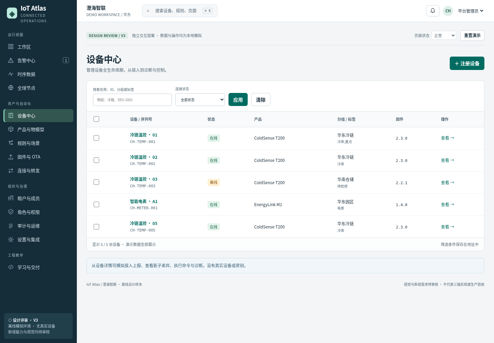
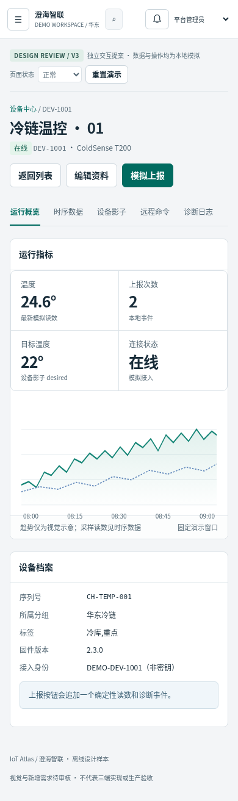

# IoT Atlas · V3 交互评审稿

> 2026-10-28：用户已批准本设计，并授权三端重新实施、推送与草稿 PR。原型仍用于设计对照，不代表正式应用或最终验收。

**待审核的独立设计原型，未替换正式 React / Vue / Angular 应用。** 本目录是修正后的评审稿，包含原型、11 张真实浏览器截图、覆盖矩阵和验证说明。

## 先看图，再体验

- [桌面设备工作区](screenshots/11-devices-desktop.png)
- [手机设备详情](screenshots/09-device-detail-mobile.png)
- [桌面运行工作区](screenshots/01-workspace-desktop.png)
- [OTA 失败恢复](screenshots/05-ota-failure-desktop.png)
- [完整设计与覆盖矩阵](DESIGN.md)
- [验证结果与限制](QUALITY.md)



<details><summary>查看手机设备详情</summary>



</details>

## 打开交互原型

原型入口是 **[index.html](index.html)**；图文审核入口是 **[START-HERE.html](START-HERE.html)**。GitHub 展示 HTML 源码，不会直接运行交互。下载当前分支或本目录后，在「交互」目录中运行：

```sh
python3 -m http.server 15110 --bind 127.0.0.1
```

在自己的浏览器访问 `http://127.0.0.1:15110/START-HERE.html`，点击“打开交互原型”。结束后按 Ctrl+C 停止服务。这是本地预览，不是已部署的网站。原型 `index.html` 的 CSS、JavaScript、SVG 全部内置，不需安装依赖或连接外部服务。本次环境限制了 `file://` 打开，已验证的是 HTTP 运行方式。

## 建议走四条流程

1. **设备接入**：设备中心 → 注册温控设备 → 填唯一序列号 → 保存 → 模拟上报 → 时序数据 → 返回列表。
2. **告警处置**：规则与场景 → 创建温度规则 → 模拟超过阈值 → 告警中心 → 确认分派 → 填原因并解决。
3. **升级恢复**：固件与 OTA → 创建批次 → 选择在线兼容设备 → 开始并推进 → 查看部分失败 → 仅重试失败设备 → 推进完成。
4. **组织治理**：租户与成员 → 模拟邀请 → 分配角色 → 调整配额 → 切换观察员验证拒绝写入。

模拟数据保存在当前浏览器中；“重置演示”恢复固定样例。可试验未保存时离开、后退、前进和刷新，以及顶部加载、空数据、失败、无权限状态。

## 覆盖边界

有 **14 个导航模块**，另有设备详情与抽屉/表单状态；这不等于 14 个完整业务系统。四条主线是 ColdSense T200 温控设备与示例租户的确定性模拟。EnergyLink M1 电表只展示能耗规格与元数据编辑，不提供温控操作。

连接器测试、通知、邀请、OTA 均不连接真实服务、不发送邮件、不操作真实设备。图表为已标明的趋势示意，查询和导出使用固定样例。完整物模型发布、多条件规则、自定义角色、真实协议、异步保存失败、生产鉴权等尚未实现，详见覆盖矩阵。

## 请审核

- 是否接受浅色密集工作区、分组导航和完整设备详情？
- 告警、角色权限、连接转发、审计的新页面哪些进入正式需求？
- 四条流程及现行权限矩阵是否合适？
- 下一步先调整设计，还是按核心模块分别落实三端？

截图和自动检查不构成用户视觉批准或最终验收。此分支未合并、未部署；正式三端仍分别独立维护代码、资源、Mock、依赖与测试。
